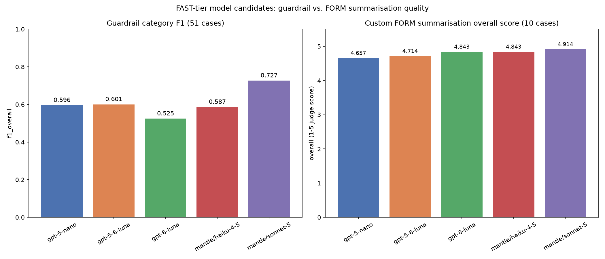

# FAST-tier replacement consideration — guardrails & form summarisation (Nov 2026)

Raw data in Sharepoint, `model_comparison_november_2026`

## Guardrail eval (accuracy category, 51 cases each, all models 51/51 complete)

| Metric | gpt-5-nano (prod) | gpt-5-6-luna | gpt-6-luna | haiku-4-5 | sonnet-5 |
|---|---:|---:|---:|---:|---:|
| Overall F1 | 0.596 | 0.601 | 0.525 | 0.587 | **0.727** |
| Exact category match | **70.6%** | 35.3% | 17.6% | 58.8% | **70.6%** |
| f1_no_issue (clean cases) | **0.773** | 0.400 | 0.000 | 0.745 | 0.588 |
| f1_factual_integrity | 0.870 | 0.522 | 0.533 | **0.880** | 0.800 |
| f1_evidence_and_citation_quality | **0.727** | 0.250 | 0.178 | 0.167 | 0.615 |
| f1_required_content_and_structure | 0.444 | **0.800** | 0.769 | 0.000 | 0.500 |
| f1_instruction_integrity | 0.500 | 0.632 | 0.667 | 0.727 | **1.000** |
| Guardrail-only cost (£/1,000 meetings) | **1.30** | 10.37 | 2.60 | 25.99 | 51.99 |

## Custom FORM summarisation eval (10 cases each, FAST-tier only)

| Metric | gpt-5-nano (prod) | gpt-5-6-luna | gpt-6-luna | haiku-4-5 | sonnet-5 |
|---|---:|---:|---:|---:|---:|
| **Overall score (/5)** | 4.66 | 4.71 | **4.84** | _blocked_ | _blocked_ |
| Summarise latency p50 (s) | 72.2 | **15.4** | 16.5 | _blocked_ | _blocked_ |

Bedrock (`haiku-4-5`, `sonnet-5`) blocked on Bedrock/APIM routing — not run on this eval.
