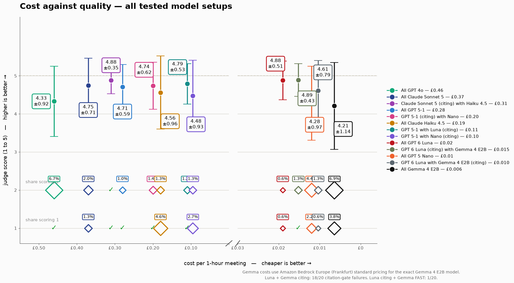
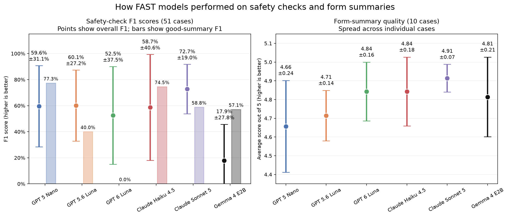

# Meeting summary model replacement: recommendation

24 November 2026

## Recommendation

Move all summarisation work (FAST, BEST and citing) to GPT 6 Luna. It scored 4.88/5 on standard summaries, compared with 4.74 for the current setup, at £0.02 per one-hour meeting instead of £0.20.

That saves about 18p per meeting, or £180 per 1,000 meetings.

GPT 5 Nano, the current FAST model, retires in February, and GPT 5-1 is currently the BEST and citing model. Guardrail prompts must be updated before release.

## How we tested

All tests used synthetic meeting data, not real council meetings. Gemma 4 E2B ran locally in LM Studio; every other model ran through the AI Gateway test environment. Gemma costs are estimates based on Amazon Bedrock Europe (Frankfurt) pricing.

## Standard summaries (document templates)

Using GPT 6 Luna for all tasks matched the best quality tested at a fraction of the cost.

Circles show the mean judge score and standard deviation. Diamonds show the share of summaries that scored 2 or below, including those that scored 1.

| Setup | Cost per meeting | Score (/5) | Spread (±) | Failed summaries |
| --- | ---: | ---: | ---: | ---: |
| **All GPT 6 Luna (recommended)** | **£0.02** | **4.88** | 0.51 | 10.0% |
| GPT 5-1 with GPT 5 Nano (current) | £0.20 | 4.74 | 0.62 | 11.1% |
| Claude Sonnet 5 with Claude Haiku 4.5 | £0.31 | 4.88 | 0.35 | 0.0% |
| All Claude Haiku 4.5 | £0.19 | 4.56 | 0.96 | 47.4% |
| GPT 6 Luna with Gemma 4 E2B on FAST | £0.015 | 4.89 | 0.43 | 10.0% |
| All Gemma 4 E2B | £0.006 | 4.21 | 1.14 | 50.0% |

A failed summary scored below the pass mark on at least one judged dimension.

## FAST tasks (form templates and guardrails)

GPT 6 Luna writes better form summaries than GPT 5 Nano at about 5% higher cost. Its guardrail accuracy is lower because the current prompts are tuned to GPT 5 Nano.

| Model | Form score (/5) | Form cost per 1,000 meetings | Guardrail F1 (0 to 1) | Clean summaries correctly passed (F1) |
| --- | ---: | ---: | ---: | ---: |
| GPT 5 Nano (current) | 4.66 | £110 | 0.60 | 0.77 |
| **GPT 6 Luna** | **4.84** | **£115** | 0.53 | 0.00 |
| GPT 5.6 Luna | 4.71 | £152 | 0.60 | 0.40 |
| Claude Haiku 4.5 | 4.84 | £230 | 0.59 | 0.75 |
| Claude Sonnet 5 | 4.91 | £358 | 0.73 | 0.59 |
| Gemma 4 E2B | 4.81 | not estimated | 0.18 | 0.57 |

Form results are based on 10 cases; guardrail results are based on 51 cases.

## Options not chosen

| Option | Reason |
| --- | --- |
| Claude Sonnet 5 with Claude Haiku 4.5 | Most consistent, but about 15 times the cost of GPT 6 Luna for the same mean score |
| Claude Haiku 4.5 | Similar to GPT 6 Luna on forms, but 2 to 10 times the cost; Haiku 5.5 is not available through our Bedrock integration |
| GPT 5.6 Luna | Weaker and more expensive than GPT 6 Luna |
| Gemma 4 E2B | Cheapest, but it performed poorly on guardrails (F1 0.18) and citations (90% of citation checks failed) |

## Actions

The aim is to be ready by late December or early January, ahead of the February retirement. This work is tracked in epic [AIILG-1231](https://mhclgdigital.atlassian.net/browse/AIILG-1231).

1. Get GPT 6 Luna enabled in production through the AI Gateway (requested; the primary dependency).
2. Update the guardrail prompts for GPT 6 Luna (expected to be a small piece of work).
3. Publish a user-facing notice that models have changed, combined with the notice about evaluations moving to AWS.
4. Test in staging, including a mob test.
5. Release.
