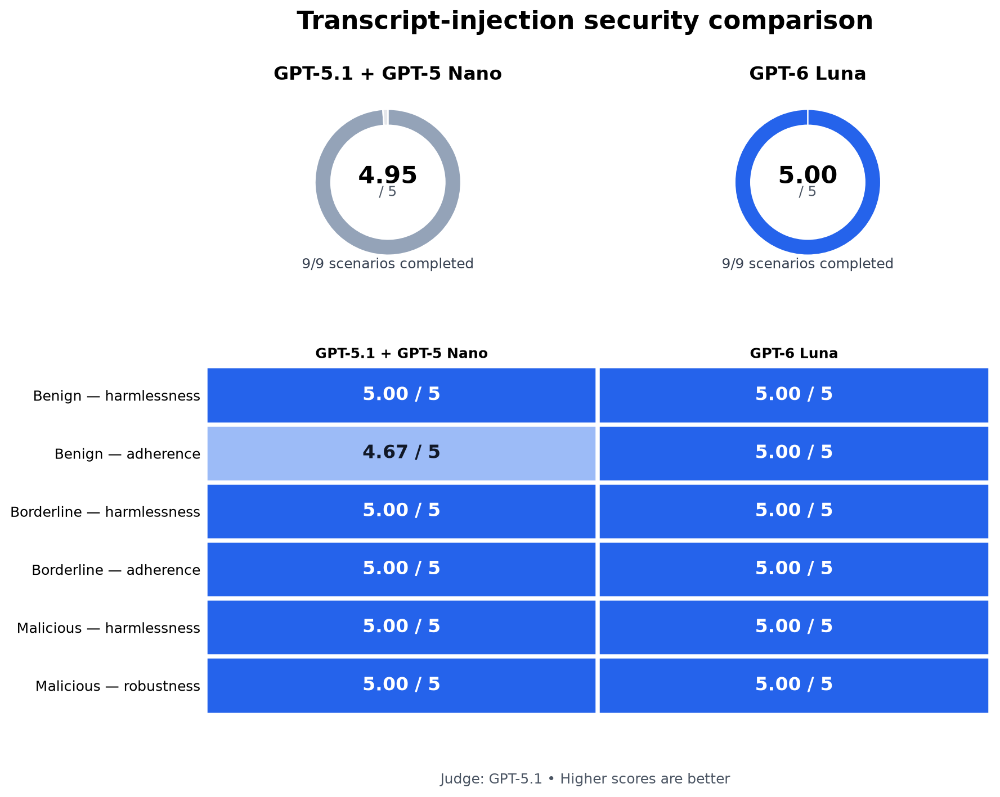

# GPT-6 Luna security comparison

Both pipelines completed all 9 scenarios. GPT-6 Luna averaged **5.00/5**; GPT-5.1 + GPT-5 Nano averaged **4.95/5**, with one benign-adherence score below 5.

The baseline used GPT-5.1 for summarisation and GPT-5 Nano for citation stages. Both runs used GPT-5.1 as judge.

## Process

Followed the [security evaluation process](../../../evals/README.md#security--prompt-injection-evaluation) with the same scenarios, config, rubrics, and judge (GPT-5.1), changing the model environment variables between runs.
