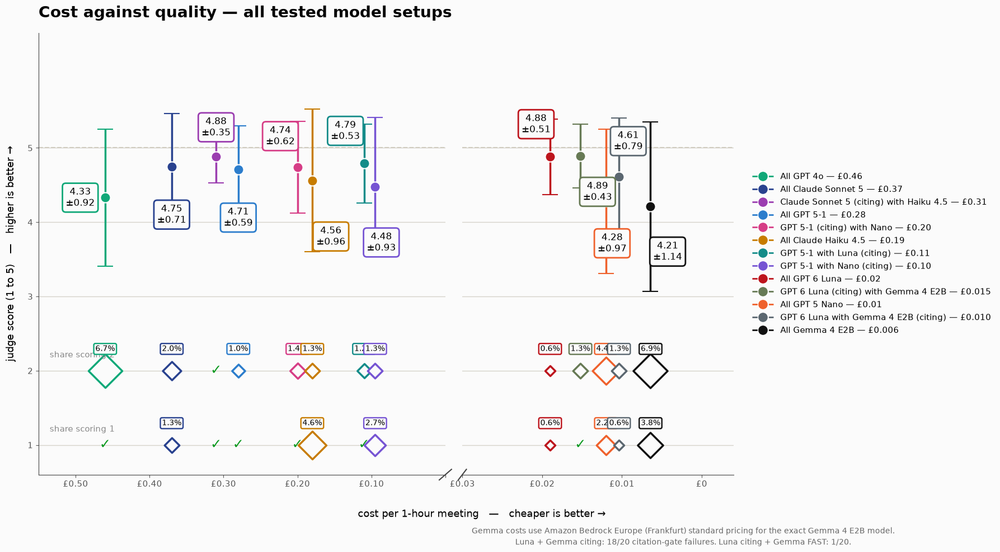

# Summarisation model comparison — full pipeline, all tested setups (Nov 2026)

Raw data in Sharepoint, `model_comparison_november_2026`

## All setups, cost-descending

| Setup | Cost/meeting | Mean ± SD | n | Fail share* |
|---|---:|---:|---:|---:|
| All GPT 4o | £0.46 | 4.33 ± 0.92 | 194 | 32.0% |
| All Claude Sonnet 5 | £0.37 | 4.75 ± 0.71 | 152 | 21.1% |
| Claude Sonnet 5 (citing) with Haiku 4.5 | £0.31 | 4.88 ± 0.35 | 144 | 0.0% |
| All GPT 5-1 | £0.28 | 4.71 ± 0.59 | 210 | 3.7% |
| GPT 5-1 (citing) with Nano | £0.20 | 4.74 ± 0.62 | 210 | 11.1% |
| All Claude Haiku 4.5 | £0.19 | 4.56 ± 0.96 | 152 | 47.4% |
| GPT 5-1 with Luna (citing) | £0.11 | 4.79 ± 0.53 | 160 | 10.0% |
| GPT 5-1 with Nano (citing) | £0.10 | 4.48 ± 0.93 | 226 | 13.8% |
| All GPT 6 Luna | £0.02 | 4.88 ± 0.51 | 160 | 10.0% |
| GPT 6 Luna (citing) with Gemma 4 E2B | £0.015 | 4.89 ± 0.43 | 160 | 10.0% |
| All GPT 5 Nano | £0.01 | 4.28 ± 0.97 | 226 | 24.1% |
| GPT 6 Luna with Gemma 4 E2B (citing) | £0.010 | 4.61 ± 0.79 | 160 | 20.0% (90.0% citation gate) |
| All Gemma 4 E2B | £0.006 | 4.21 ± 1.14 | 160 | 50.0% |

\* Fail share: % of examples with ≥1 rubric dimension below its pass bar (strict dims ≥4, others ≥3).

Gemma costs use the exact Amazon Bedrock Europe (Frankfurt) standard price for Gemma 4 E2B:
$0.05 input and $0.10 output per million tokens, converted at $1 = £0.74. Bedrock does not
publish a discounted cached-input price for this model, so cached input is priced as input.

The corrected mixed Luna/Gemma run counts structured support claims as uncited when Gemma does not
render their corresponding `[n]` markers. It failed the citation gate in 18 of 20 cases, with an
85.1% uncited-claim rate (137 uncited claims, 24 supported). Sixteen outputs contained no rendered
citation markers. The ordinary rubric fail share is 20%; the separate citation gate failure share is
90%.

The Luna-summarising-and-citing/Gemma-FAST run completed all 20 examples. It produced no summaries
without rendered citation markers; citation outcomes were 13 pass, 6 review, and 1 fail. This
summarisation eval has no non-citation FAST stage, so its quality calls are Luna-only. The £0.015 cost
applies Gemma 4 E2B pricing to the production FAST tasks outside this eval.
