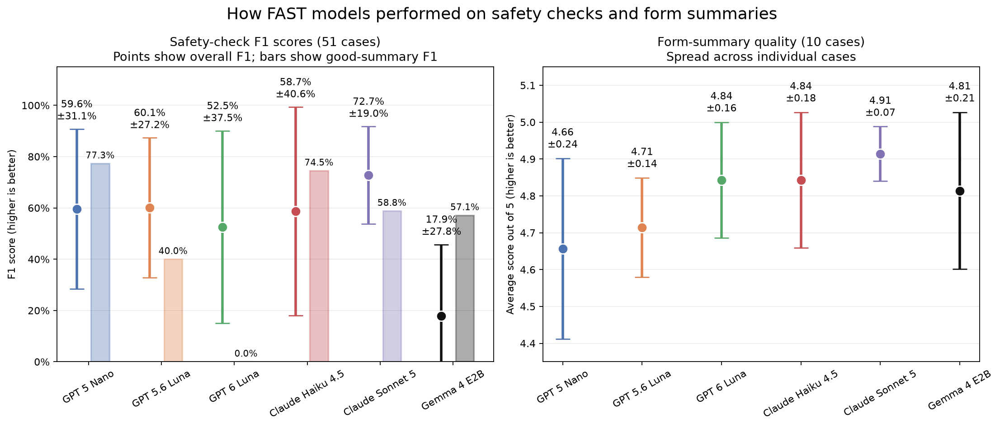

# FAST-tier replacement consideration — guardrails & form summarisation (Nov 2026)

Raw data in Sharepoint, `model_comparison_november_2026`

## Safety-check evaluation (51 cases each, all models completed every case)

| Metric | gpt-5-nano (prod) | gpt-5-6-luna | gpt-6-luna | haiku-4-5 | sonnet-5 | gemma-4-e2b |
|---|---:|---:|---:|---:|---:|---:|
| Overall F1 | 59.6% | 60.1% | 52.5% | 58.7% | **72.7%** | 17.9% |
| Exact category match | **70.6%** | 35.3% | 17.6% | 58.8% | **70.6%** | 41.2% |
| Good summaries accepted (F1) | **77.3%** | 40.0% | 0.0% | 74.5% | 58.8% | 57.1% |
| Factual integrity (F1) | 87.0% | 52.2% | 53.3% | **88.0%** | 80.0% | 0.0% |
| Evidence and citation quality (F1) | **72.7%** | 25.0% | 17.8% | 16.7% | 61.5% | 0.0% |
| Required content and structure (F1) | 44.4% | **80.0%** | 76.9% | 0.0% | 50.0% | 0.0% |
| Instruction integrity (F1) | 50.0% | 63.2% | 66.7% | 72.7% | **100.0%** | 0.0% |
| Safety-check cost per meeting | 0.13p | 1.04p | 0.26p | 2.60p | 5.20p | **0.12p** |

## Form-summary evaluation (10 cases each, FAST models only)

| Metric | gpt-5-nano (prod) | gpt-5-6-luna | gpt-6-luna | haiku-4-5 | sonnet-5 | gemma-4-e2b |
|---|---:|---:|---:|---:|---:|---:|
| **Overall score (/5)** | 4.66 | 4.71 | 4.84 | 4.84 | **4.91** | 4.81 |
| Summarise latency p50 (s) | 72.2 | 15.4 | 16.5 | **8.8** | 17.9 | 105.3 |

Bedrock (`haiku-4-5`, `sonnet-5`) results use the same 10-case form-summary evaluation.
Gemma completed 10/10 cases using LM Studio for FAST generation and `gpt5-1` as judge.
